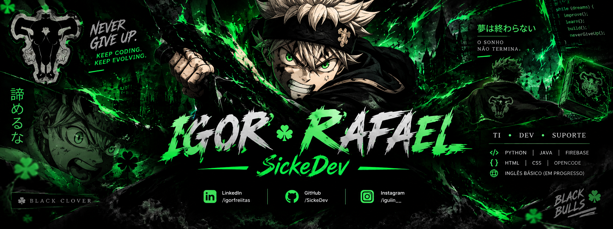

  

 

  <h3>⚔️ Igor Rafael | SickeDev</h3>
  
💻 Tecnologia da Informação • Desenvolvimento • Never Give Up!

  **「 超えられない壁なんてない 」**  
  *Não existe parede que não possa ser superada.*

  💻 Tecnologia • 👨‍💻 Desenvolvimento • ⚔️ Determinação

  
  
  

---

## 🧑‍💻 Sobre mim

Olá! Seja bem-vindo ao meu grimório digital! 📖⚔️

Sou **Auxiliar de Tecnologia da Informação**, formado como **Técnico em Informática pelo IFMT**, com experiência em suporte técnico, manutenção de computadores e configuração de sistemas em ambiente corporativo.

🎓 Atualmente, estou cursando:

- 📚 **Análise e Desenvolvimento de Sistemas (TADS)** — IFMT
- 💻 **Engenharia de Software** — Unigrande

🛠️ Atuo no atendimento a usuários, diagnóstico e resolução de problemas relacionados a hardware, software e redes, contribuindo para a continuidade e eficiência dos serviços de TI.

🚀 Sou um profissional proativo, organizado e orientado à solução de problemas, sempre buscando aprender novas tecnologias, aprimorar minhas habilidades e evoluir profissionalmente na área de tecnologia.

---

## 🧰 Meu arsenal tecnológico

*Skills em desenvolvimento — evoluindo um nível de cada vez!*

  

### ⚡ Habilidades em progresso

| Habilidade | Status |
|:--|:--|
| 🐍 Python | 📚 Em aprendizado |
| ☕ Java | 📚 Em aprendizado |
| 🌐 HTML5 | 📚 Em aprendizado |
| 🎨 CSS3 | 📚 Em aprendizado |
| 🇺🇸 Inglês | 📈 Em evolução |

---

## 💼 Experiência em TI

- 🖥️ Suporte técnico e atendimento ao usuário.
- 🔧 Manutenção preventiva e corretiva de computadores.
- ⚙️ Configuração e suporte a sistemas.
- 🌐 Diagnóstico e resolução de problemas de redes.
- 🏢 Suporte a ambientes corporativos.
- 📖 Aprendizado contínuo em programação e desenvolvimento de software.

---

## 📊 Estatísticas do GitHub

  

  

  

---

## 🎯 Meus objetivos

- 🚀 Evoluir minhas habilidades em programação.
- 💻 Desenvolver projetos práticos e úteis.
- 🧠 Aprofundar meus conhecimentos em Engenharia de Software.
- 🌐 Aprimorar meu inglês e minhas habilidades técnicas.
- ⚔️ Transformar conhecimento em soluções reais.

---

## 🌐 Conecte-se comigo

  💼 **LinkedIn:** [linkedin.com/in/igorfreiitas](https://www.linkedin.com/in/igorfreiitas/)

  🐙 **GitHub:** [github.com/SickeDev](https://github.com/SickeDev)

  📸 **Instagram:** [@iguiin__](https://www.instagram.com/iguiin__/)

---

  ### ⚔️「 Meu grimório está apenas começando... 」

  🖤 **Never Give Up. Keep Coding. Keep Evolving.** 💚

  

